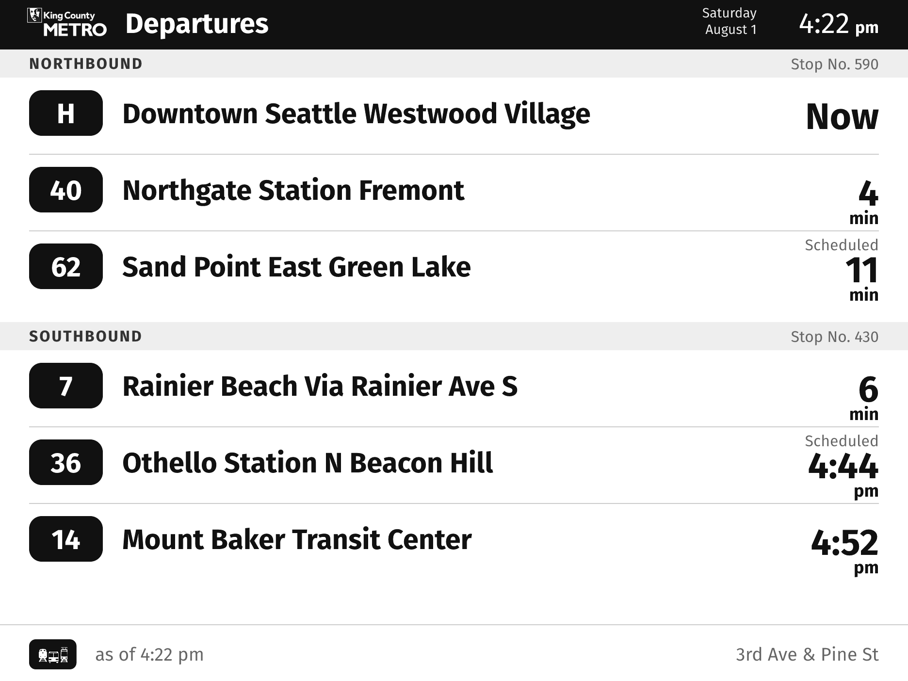
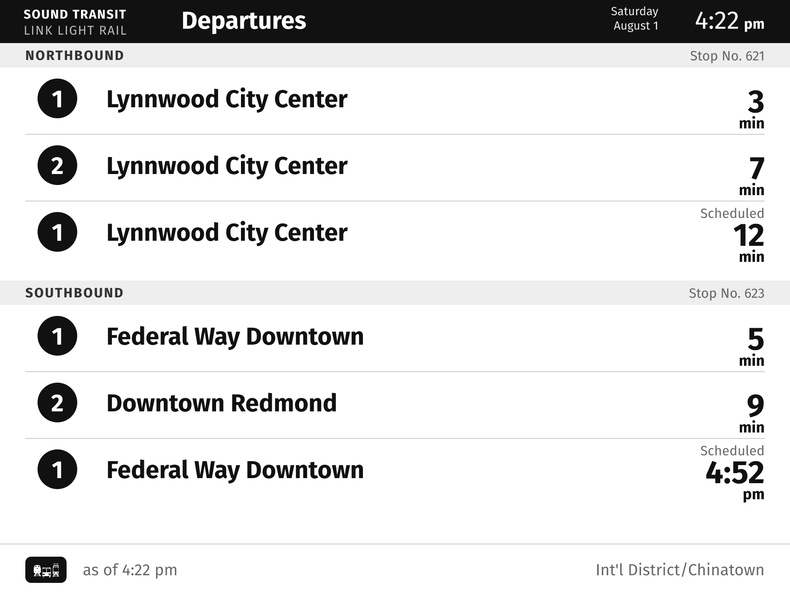

# TRMNL X Orca Departures

An e-paper sign showing live [King County Metro](https://kingcounty.gov/en/dept/metro) departures for a single stop, styled after Metro's real [Connectpoint](https://www.connectpointinc.com/) stop signs.

A [TRMNL X](https://trmnl.com/) device wakes on an interval and polls a [Cloudflare Worker](https://www.cloudflare.com/products/workers/). The Worker fetches predictions from [OneBusAway](https://pugetsound.onebusaway.org/), renders a `1872x1404` greyscale PNG, and serves it back. All the scheduling and rendering logic lives on the server; the device only displays what it is handed.

**It runs entirely serverless on a free Cloudflare Worker.** Nothing runs on your home network and nothing runs on your computer — no Pi, no NAS, no always-on box, no container, no port forwarding, and no laptop that has to stay awake for the sign on the wall to keep working. A full render costs about 58 ms of CPU against a ~1000 ms per-invocation ceiling, so the free plan is not a starting tier to grow out of; it is the whole hosting story.

## Documentation

- **[How it works](docs/how-it-works.md)** — why BYOS rather than a plugin, the three endpoints, and the two design constraints everything else follows from: the content-hash `filename` and the "as of" timestamp.
- **[Deploying](docs/deploying.md)** — running your own sign: OneBusAway key, finding your stop IDs, your own Cloudflare Worker, pairing the device, and every configuration value.
- **[Development](docs/development.md)** — working on the code: local dev, the design preview, what lives where, and the firmware traps that fail silently.

## License

GPL v2 or later.
